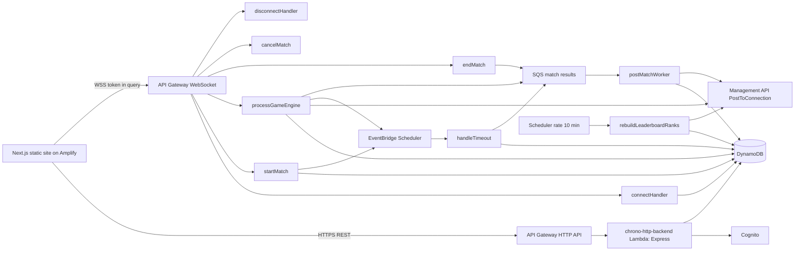

# TCG / Kaleidoscope Game: Project Architecture

> Updated on 2026-10-06 from a full scan of the repository source (Back-end, Front-end, scripts, `.agents/` plans and rules). It describes behavior verified in code. Items marked **INFERRED** come from plan documents or naming rather than checked-in infrastructure, and items marked **UNKNOWN** cannot be proven from the repository.

## 1. Project Overview

Chrono Genesis / Kaleidoscope TCG is a TypeScript 1v1 collectible card game (inspired by Legends of Runeterra) with a Next.js frontend, a shared authoritative game engine, and a serverless AWS backend.

The backend has two coexisting runtimes that share the same game engine:

- **Production path:** API Gateway HTTP (one Express Lambda) plus API Gateway WebSocket (one Lambda per route). Matches are durable aggregates in DynamoDB. Redacted state is pushed through the API Gateway Management API.
- **Local/prototype path:** `Back-end/src/server/index.ts` starts Express + Socket.IO with in-memory rooms, matchmaking and timers (`npm run dev:socket`, port 5000).

The Front-end also bundles the engine (through the `@backend/*` path alias) so that **trial mode** and the local board run entirely in the browser with `useLocalGame`.

The repository does not contain backend infrastructure definitions. `amplify.yml` configures only the Next.js build. API Gateway routes, Lambda settings, IAM policies, the SQS event source mapping, Scheduler groups and Cognito identifiers are described only in `.agents/plan/docs/*` (manual AWS Console steps) and are **UNKNOWN** from source alone.

## 2. Technology Stack

| Area | Technology / evidence |
|---|---|
| Language/runtime | TypeScript (strict), ESM, Node.js >=24 (`.nvmrc` = 24), npm >=9 |
| Frontend | Next.js 15.5, React 19, Tailwind CSS 4 (`@tailwindcss/postcss`), Zustand 5, framer-motion, lucide-react / react-icons, `@base-ui/react`, shadcn/class-variance-authority, react-dnd, `react-parallax-tilt`, tsparticles |
| Game rendering | Phaser 4.2.1 (loaded with dynamic `import("phaser")`); battlefield uses `Phaser.CANVAS`, the lobby splash uses `Phaser.WEBGL` |
| Frontend AWS SDK | `aws-amplify` is listed in `package.json` but is not imported anywhere in `src`; authentication goes through the project's own HTTP API |
| HTTP backend | Express 5, `@codegenie/serverless-express` 5, `cookie-parser`, `cors` |
| Realtime | API Gateway WebSocket + Management API (production); `socket.io` / `socket.io-client` (local) |
| Authentication | Amazon Cognito (`@aws-sdk/client-cognito-identity-provider`), JWKS verification with `jose` |
| Persistence | DynamoDB Document Client (`@aws-sdk/lib-dynamodb`) |
| Async processing | SQS (`@aws-sdk/client-sqs`), EventBridge Scheduler (`@aws-sdk/client-scheduler`) |
| Optional credentials | `@aws-sdk/client-secrets-manager`, `@aws-sdk/credential-providers` (opt-in only, see section 15) |
| Build/deploy evidence | Amplify frontend build, esbuild Lambda bundling (`scripts/*.mjs`) |
| Testing | Vitest 2 (25 `*.test.ts` files under `Back-end/src`); `npx tsc --noEmit` |

Root `package.json` is shared by both apps. The `@backend/*` alias maps to `Back-end/src/*` in the root and Front-end `tsconfig.json`, and `next.config.ts` enables `experimental.externalDir` and `images.unoptimized`.

## 3. Project Structure

```text
TCG-AWS/
├── .agents/
│   ├── rule/rule.md              Mandatory AI-agent rules (read before any change)
│   └── plan/{docs,fix-error,UI}  AWS runbooks, bug write-ups, UI plans
├── Front-end/
│   ├── src/app/                  Next.js App Router pages (see section 6)
│   ├── src/client/MultiplayerDuel.tsx   Local Socket.IO lobby used by /duel
│   ├── src/components/
│   │   ├── game/                 GameBoard, cards, HUD, zones, spell-effect-layer
│   │   │   └── phaser/           adapters, config, renders, scenes, systems, types
│   │   ├── lobby/                AuthGuard, PhaserSplash, ChronoCommandCompass, PrivateRoomScreen, dialogs
│   │   ├── matchmaking/          FindMatchConsole, MatchFoundShowcase, avatar/biometric/vortex effects
│   │   ├── deck/ rank/ user/ audio/ auth/ gallery/ ui/button/
│   ├── src/hooks/                useGameMatch, useLocalGame, useGameStore, useBattleMusic, useLeaderboard, useRealtimeRank, useLoopingAudio
│   ├── src/libs/                 api, socket, apiGatewaySocket, arenaEventBus, audioManager, profileCache, localDecks
│   ├── src/contexts/             AudioContext, HoverContext
│   └── public/                   audio, splash, art, monster assets
├── Back-end/src/
│   ├── auth/                     Cognito operations, JWT verification, Express middleware
│   ├── aws-lambdas/              WebSocket, scheduler, SQS and rebuild Lambda entry points (+ test-lambda/)
│   ├── config/                   env validation, DynamoDB client
│   ├── database/                 setupTables.ts, database.types.ts (legacy shapes)
│   ├── decks/                    deck payload validation
│   ├── game/
│   │   ├── core/                 engine.ts, authoritativeAction.ts, events.ts
│   │   ├── rules/                gameRules.ts, deckRules.ts
│   │   ├── operations/           atomic state mutations
│   │   ├── mechanics/            abilities, effects, triggers, graveyard
│   │   ├── entities/             cards, cardRegistry, defaultDeck, sampleCards
│   │   ├── data/                 archetypeCards.json, UiaCard.json
│   │   └── types.ts
│   ├── http/                     app.ts and route modules
│   ├── leaderboard/              projection/sort key, realtime notifications
│   ├── matchmaking/              local-only queue, ELO helper
│   ├── shared/multiplayer.ts     Contracts shared with the frontend
│   ├── server/index.ts           Local Express + Socket.IO runtime
│   └── user/                     Profile/deck repository and service
├── scripts/                      build-lambda.mjs, build-http-lambda.mjs
├── amplify.yml                   Frontend build only
├── Architecture.md / PROJECT_ARCHITECTURE.md (+ _vi translations)
└── package.json, tsconfig.json, vitest.config.ts
```

Notes verified in the tree:

- `Back-end/src/aws-lambdas/dist/` contains committed build output (about 20 tracked files).
- `package.json` defines `db:seed` (`Back-end/src/database/seedData.ts`), but that file does not exist.
- `Back-end/src/game/data/UiaCard.json` is not imported by `cardRegistry.ts`; only `archetypeCards.json` is registered.
- `Front-end/src/components/lobby/MatchRecoveryPhaserLoader.tsx` and `Front-end/src/hooks/useLoopingAudio.ts` are not referenced by any other file.

## 4. Architecture Overview



Lambda invocations are stateless. `GameState.engine_state` is the authoritative snapshot, and conditional writes provide optimistic concurrency.

## 5. Module / Component Responsibilities

### Front-end

- **Pages** (`src/app`): thin route files that compose components and guard authentication with `AuthGuard`.
- **`hooks/useGameMatch.ts`:** owns the realtime match lifecycle (connect, token refresh, matchmaking, rooms, resume handshake, `room:update`, dispatch). Returns a `SocketGameController`.
- **`hooks/useLocalGame.ts`:** same controller shape, but runs `applyAuthoritativeAction` locally for trial and local battles.
- **`libs/socket.ts` (`SocketManager`):** chooses the transport. If `NEXT_PUBLIC_WS_URL` is set it uses `ApiGatewaySocket`; otherwise Socket.IO against `NEXT_PUBLIC_SOCKET_URL` (default `http://localhost:5000` in development).
- **`libs/apiGatewaySocket.ts`:** native WebSocket with exponential reconnect (1s doubling to 15s). It normalizes `room:update` / `matchmaking:found` into the `RoomUpdate` contract and forwards other events by name.
- **`libs/api.ts`:** the single REST client (`request()` adds the Bearer token from localStorage and `credentials: "include"`). It exposes auth, profile, deck, pending-match, leaderboard and history calls.
- **`libs/profileCache.ts`:** stale-while-revalidate cache in localStorage (`user_profile`, `pending_match_state` with 60 s TTL) plus `warmupUserSession()` (2 s budget, parallel `me`, pending match, decks, rank).
- **`libs/localDecks.ts`:** local deck store (`kaleidoscope.saved-decks`, selected deck id) merged with cloud decks; the default deck id `kaleidoscope-starter` is reserved.
- **`libs/audioManager.ts`:** singleton BGM crossfade and SFX pool with persisted settings. `contexts/AudioContext.tsx` exposes it through `useGlobalAudio()`.
- **`components/game/GameBoard.tsx`:** about 2,100 lines. Renders the HUD, hand, pending-choice and graveyard flows, turn countdown, AFK toasts, surrender dialog and the result screen. It dispatches only through `controller.dispatch`.
- **Phaser layer** (`components/game/phaser`): `PhaserArenaCanvas` creates one `Phaser.Game`; `GameArenaScene` coordinates systems (`ArenaStateSystem`, `ArenaInputSystem`, `CardInteractionSystem`, `CardAnimationManager`, `CombatVFXSystem`, `ArenaBackgroundManager`, `TextureLoader`) and renderers (`ArenaBoardRenderer`, `BoardEffectsRenderer`, `CardLaneRenderer`, `CardRenderer`).

### Back-end

- **HTTP layer:** `http/app.ts` applies the origin check, JSON/cookie parsing, mounts routes, `/health`, 404 and error handling. `aws-lambdas/httpBackend.ts` wraps it for Lambda.
- **Auth:** `auth.service.ts` (Cognito flows), `auth.controller.ts` (cookies and responses), `verifyToken.ts` (issuer, JWKS, `token_use`, client id), `auth.middleware.ts` (Bearer header first, then `access_token` cookie).
- **Match lifecycle Lambdas:** `connectHandler`, `startMatch`, `processGameEngine`, `handleTimeout`, `endMatch`, `cancelMatch`, `disconnectHandler`.
- **Results and rankings:** `matchResultQueue.ts` (publish to SQS), `postMatchWorker.ts`, `rebuildLeaderboardRanks.ts`, `leaderboard/leaderboard.ts`, `leaderboard/realtime.ts`.
- **Game engine:** see section 16.
- **Local server:** `server/index.ts` mounts `/auth`, `/matches`, `/user`, and its own `/decks`. It does **not** mount `/leaderboard`, so the rank page has no local backend.

## 6. Application Entry Points & Lifecycle

### Frontend routes (Next.js App Router, statically prerendered)

| Route | Purpose |
|---|---|
| `/` | Lobby shell with `ChronoCommandCompass` tabs: duel, custom, trial, deck, collection, rank global, history; profile, sign-out and sound dialogs; `PhaserSplash` backdrop |
| `/play` | Public matchmaking (`useGameMatch`), pending-match dialog, searching overlay, `MatchFoundShowcase`, then `GameBoardView`. `?room=CODE&resume=1` resumes a match; `?trial=1` runs the local trial game |
| `/room-create`, `/room-join` | Private rooms through `PrivateRoomScreen` (mode `create` / `join`); the join link format is `/room-join?room=CODE` |
| `/deck-builder`, `/gallery`, `/history`, `/rank`, `/user` | Deck editing/saving, card gallery (public), match history, leaderboard, profile management |
| `/login`, `/register`, `/verify`, `/forgot-password`, `/reset-password` | Authentication forms using `AuthShell` |
| `/duel` | Local Socket.IO lobby (`client/MultiplayerDuel.tsx`) |

`AuthGuard` initializes from the cached profile and verifies with `me()`. `npm run dev` runs `next dev Front-end`; Amplify runs `nvm use 24`, `npm ci`, `npm run build` with `appRoot: Front-end` and artifacts from `Front-end/.next`.

### HTTP production path (INFERRED from `.agents/plan/docs/http-backend-lambda-deployment.md`)

An HTTP API with a single `$default` route forwards everything to Lambda `chrono-http-backend` (Node 24, 512 MB, 30 s, handler `index.handler`, payload format 2.0). Express handles the request.

### WebSocket production path

1. The browser refreshes the Cognito access token if it expires within 60 s, then opens `NEXT_PUBLIC_WS_URL?token=...&username=...`.
2. `connectHandler` verifies the token, resolves the stored username, writes `Connections`, and rebinds an unfinished `IN_PROGRESS` match to the new connection id (player marked disconnected, `resume_required` set) or a `WAITING` private room owned by the user.
3. The client sends route messages. Route names used by the frontend are `matchfinding-start` (overridable with `NEXT_PUBLIC_MATCHMAKING_ROUTE`), `room-create`, `room-join`, `game-action`, `game-surrender` and `matchfinding-cancel`. Their Lambda targets are **INFERRED**: `startMatch` serves the first three, `processGameEngine` serves `game-action`, `endMatch` serves surrender and `cancelMatch` serves cancel.
4. `disconnectHandler` deletes stale WAITING queue entries and marks active players disconnected, notifying the opponent.
5. EventBridge Scheduler invokes `handleTimeout` with a JSON payload.

### Local lifecycle

`npm run dev:socket` creates the HTTP server, mounts Express routes and attaches Socket.IO with token auth. Rooms, timers (`refreshTimer`) and a 45-second disconnect forfeit grace are process-local.

## 7. Main Flows

### Registration, login, session

Registration validates email/username/deletion cooldown, calls Cognito `SignUp`, and `verify` confirms the code. `login` returns access/ID/refresh tokens, `ensureUserProfile` creates the profile, and the API also sets `access_token`, `email` and `refresh_token` cookies (httpOnly; `secure` + `sameSite=none` in production). The frontend additionally stores `accessToken`, `refreshToken` and `email` in localStorage and calls `warmupUserSession()` before redirecting.

### Matchmaking and rooms

`startMatch.ts` loads the authoritative profile, validates the deck selection (`resolveDeckSelection`), and handles resume. Public matching takes a global DynamoDB lock item (`__MATCHMAKING_LOCK__`, 10 s TTL) in the `GameState` table, scans `WAITING` matches within the ELO range (default 200), and claims one with a conditional update. Private rooms use a 6-character code from the alphabet `ABCDEFGHJKLMNPQRSTUVWXYZ23456789`. `claimMatch` runs `START_GAME`, offsets the first `turnStartTime` by 10 s for the `MatchFoundShowcase`, schedules the first timeout, and flips the record to `IN_PROGRESS`.

### Authoritative action

```mermaid
sequenceDiagram
  participant B as Browser
  participant L as processGameEngine
  participant D as GameState table
  participant E as Game engine
  participant W as Management API
  B->>L: game-action {matchId, action}
  L->>D: GetItem (ConsistentRead)
  L->>L: derive P1/P2 from connection_id, reject mismatched playerId
  L->>L: reject RESOLVE_COMBAT; TIME_OUT only if turn expired
  L->>E: applyAuthoritativeAction
  E-->>L: next state or validation error
  L->>D: conditional update (status, state_version, turn fields, priority)
  L->>W: room:update (redacted per player)
  L->>L: write GameLogs, schedule next timeout, enqueue result if finished
```

The turn timeout schedule is set only after the DynamoDB commit succeeds (in parallel with the state push), so a lost conditional write never touches it.

### Timeout (hybrid, two tiers)

Tier 1: either player's client dispatches `TIME_OUT`. The holder of the turn does so when its countdown reaches zero (tier 1a); the opponent does so `OPPONENT_CLAIM_DELAY_MS` (1.5 s) after the deadline (tier 1b), which covers a holder who closed the tab. `processGameEngine` validates with `holderMayReportTimeout` for the holder (`TIMEOUT_EARLY_TOLERANCE_MS`, 500 ms early) and `opponentMayClaimTimeout` for the opponent (both in `game/rules/turnClock.ts`), always times out the player who holds the priority, and answers a refused or lost report with a silent `409`. Ordinary actions are never refused before the deadline and are refused by `actionIsTooLate` only after `ACTION_LATE_TOLERANCE_MS` (1.5 s) past it. Every message that carries state includes `serverTime`, from which the client derives `clockOffsetMs` and reads the turn clock in server time.

Tier 2: one EventBridge Scheduler schedule per match (`at()` one-time, name `turn-<matchId>`, `ActionAfterCompletion: NONE`, two retries, 300 s max event age). Every committed state updates it to the new deadline plus `ACTION_LATE_TOLERANCE_MS` (`UpdateSchedule`, or `CreateSchedule` when there is none), and a timeout that ends the match deletes it (a match ended by surrender leaves it to delete itself the next time it fires). It fires only when no client reported the timeout. `handleTimeout` deletes the schedule of a match that is over, times out the due player (only once `actionIsTooLate`, so the watchdog never takes a turn from a late click the engine would still accept) when the schedule matches the turn, and otherwise points the schedule at the turn the match is really in (a stale or early schedule). See `.agents/plan/fix-error/watchdogEB.md`.

### Reconnect / resume

Reload shows `PendingMatchDialog` (Continue or Leave) from `GET /matches/pending`. Continue navigates to `/play?room=CODE&resume=1`; `useGameMatch` sends `{resume: true, matchId}` through the matchmaking route and retries up to seven times while `$connect` finishes rebinding. Leave calls `POST /matches/pending/forfeit`.

### Completed match

The engine sets `winnerId`/`endReason`, the Lambda writes `FINISHED`, and `matchResultQueue.ts` sends the match id (plus informational players and winner) to SQS. `postMatchWorker` rereads GameState, rejects unfinished or malformed matches, computes ELO, and commits one `TransactWrite` containing both profiles (with leaderboard projection), both `MatchHistory` rows and the `post_match_processed_at` marker. It then sends best-effort `profile:updated` events. Every 10 minutes `rebuildLeaderboardRanks` scans profiles, assigns exact ranks with conditional updates, and sends `rank:changed`.

## 8. Data Flow

1. Cognito supplies identity; the application uses `sub` as `user_id`.
2. The profile holds username, avatar, stats (ELO default 1000, wins, losses, exp, level), saved decks and leaderboard projection fields.
3. Match start turns selected or default card ids into card instances and stores the initial engine state in `GameState`.
4. Each action reads, validates, transforms and conditionally replaces `engine_state`.
5. Outbound state is redacted per player with placeholder `hidden-card` instances for the opponent's hand and deck. This logic is copied in several files (see section 19).
6. `GameLogs` records action, timeout and end entries.
7. SQS carries only a completion signal; the worker trusts the committed GameState.
8. The frontend keeps a non-authoritative copy in React state, mirrors it to the Zustand `useGameStore`, and drives Phaser through `arenaEventBus`.

## 9. Event Flow

- **In-game synchronous events:** `core/events.ts` and `mechanics/triggers.ts` emit `CARD_PLAYED`, `SPELL_CAST`, `UNIT_DIED`, `NEXUS_DAMAGED`, `CHAMPION_LEVELED_UP` and similar. `emitEvent` updates champion/ability progress and runs triggered abilities, which enqueue effects.
- **AWS asynchronous events:** WebSocket route events, EventBridge Scheduler invocations (turn timeout and the 10-minute rank rebuild), and SQS batches to `postMatchWorker`.
- **Server to client messages:** `room:update`, `room:created`, `matchmaking:found`, `matchmaking:searching`, `matchmaking:cancelled`, `match:resume_required`, `match:ended`, `game:error`, `profile:updated`, `rank:changed`.
- **Frontend UI events:** `arenaEventBus` carries `UPDATE_SLOTS`, `SUMMON_UNIT`, `ATTACK_UNIT`, `DESTROY_UNIT`, `HOVER_UNIT`, `SELECT_UNIT`, `EMPTY_SLOT_CLICK`, `TARGETING_CHANGED`, `CAMERA_CHANGE`. Listener calls are wrapped in try/catch.

## 10. State Management & State Transitions

Match record states: `WAITING -> IN_PROGRESS -> FINISHED`. Cancel, disconnect and expiry delete waiting entries; timeout, surrender and Nexus destruction end active matches; the post-match worker adds history and rating.

Engine phases: `ACTION -> BLOCK -> COMBAT -> ACTION`, with `DISCARD` and `pendingChoice` acting as blocking sub-states. Rounds alternate the attack token, and each round gives +1 max mana, refreshes the board and draws a card.

`validateAction` rejects actions after a winner, before start, in the wrong phase or priority, and during unresolved discard or choice (except `TIME_OUT` and `SURRENDER`). `checkWinConditions` handles Nexus destruction and double destruction (priority player wins). AFK: 30 s turns, 15 s after any AFK strike, three consecutive timeouts lose.

Frontend state: React state in `useGameMatch` (status, searching, queue time, resume info), the engine snapshot in `gameState`, and a mirror in `useGameStore` (selection, hover, targeting line, camera preset). Phaser reads only the store and event bus.

## 11. API / Service Communication

### HTTP routes (Express, `http/app.ts`)

| Prefix | Routes |
|---|---|
| (public) | `GET /health` |
| `/auth` | `POST register, verify, login, logout, refresh, forgot-password, reset-password, resend-code`; `GET /me` (auth) |
| `/matches` | `GET /pending`, `POST /pending/cancel`, `POST /pending/forfeit`, `GET /history` |
| `/decks` | `GET /`, `POST /` |
| `/leaderboard` | `GET /` (cursor pagination through `LeaderboardIndex`), `GET /me` |
| `/user` | `GET /`, `PATCH /avatar`, `PATCH /username` (30-day cooldown), `DELETE /account` (24-hour re-registration cooldown) |

All except the public auth routes use `authenticate`. The origin check allows `FRONTEND_ORIGINS` and any origin ending in `amplifyapp.com`.

### WebSocket contract

The production client routes are listed in section 6. The local Socket.IO contract (`shared/multiplayer.ts`) uses `matchmaking:start`, `matchmaking:cancel`, `room:create`, `room:join`, `game:action`, `game:reset` and `developer:resources`. `SocketManager` translates between the two (for example SURRENDER becomes route `game-surrender`; reset and developer resources are disabled on API Gateway).

### Outbound transport

Lambdas use `PostToConnectionCommand`; a `GoneException` (410) is treated as normal cleanup. The browser uses a native `WebSocket` for API Gateway and `socket.io-client` locally.

## 12. Database / Data Model

| Table | Key | Role |
|---|---|---|
| `UserProfile` | `user_id`; GSI `LeaderboardIndex` (`leaderboard_scope` + `leaderboard_sort`, projection ALL) | identity, stats, saved decks, rank and projection |
| `AccountDeletionCooldown` | `email` | 24-hour re-registration lock after deletion |
| `GameState` | `match_id` | match record, players, connection ids, engine snapshot, versions; also holds the `__MATCHMAKING_LOCK__` item; TTL attribute `expire_at` |
| `GameLogs` | `match_id` + `action_sequence` | action, timeout and end audit entries |
| `Connections` | `connection_id` | authenticated socket, `user_id`, bound `match_id`, `resume_required` |
| `MatchHistory` | `user_id` + `played_at` | per-player completed match rows |

`setupTables.ts` creates all tables on-demand and adds `LeaderboardIndex` to an existing `UserProfile`. It does **not** enable the TTL on `GameState.expire_at`; the runbook says to enable it manually.

Query patterns: the leaderboard uses `Query` on the GSI. Scans are used for public matchmaking (`WAITING`), pending-match lookup, connection rebinding on `$connect` and `$disconnect`, `findUserByUsername` / `getUserByEmail` / `ensureUserProfile` duplicate checks, and the rank rebuild. The legacy snake_case `database.types.ts` does not match the active camelCase engine state.

## 13. Authentication & Authorization

- Cognito is the identity provider (registration, confirmation, login, refresh, logout, password recovery, global sign-out, account deletion).
- HTTP: `authenticate` accepts `Authorization: Bearer` first, then the `access_token` cookie, and verifies issuer/JWKS, `token_use=access` and client id.
- WebSocket: `$connect` accepts `?token=` or a Bearer header and runs the same verification. Per-message identity comes from the stored `connection_id`.
- `processGameEngine` rejects client `RESOLVE_COMBAT`, mismatched `action.playerId`, stale turns and unauthorized connections.
- Frontend: the access token lives in localStorage and is refreshed through `ensureFreshAccessToken` / `refreshToken`. Cookies are also set by the API.
- **Risks:** WebSocket tokens in the query string can appear in access logs; tokens in localStorage are exposed to XSS.

## 14. External Integrations

- Amazon Cognito (user pool and JWKS), DynamoDB, API Gateway WebSocket + Management API, SQS (completed matches), EventBridge Scheduler (per-turn timeout and the 10-minute rank rebuild), Amplify Hosting (frontend only).
- Optional Secrets Manager / STS credential paths in `config/dynamodb.ts`.
- Card artwork in `archetypeCards.json` / `UiaCard.json` is hot-linked from third-party hosts (for example ygoprodeck, tenor, pinimg). Phaser therefore uses the Canvas renderer to avoid CORS failures.

## 15. Configuration & Environment

Backend: `AWS_REGION` / `DB_REGION` (default `ap-southeast-1`), `COGNITO_REGION`, `COGNITO_USER_POOL_ID`, `COGNITO_CLIENT_ID`, optional `COGNITO_CLIENT_SECRET`, `FRONTEND_ORIGINS`, table names (`USER_PROFILE_TABLE`, `GAME_STATE_TABLE`, `GAME_LOGS_TABLE`, `CONNECTIONS_TABLE`, `MATCH_HISTORY_TABLE`), `LEADERBOARD_INDEX`, `WS_MANAGEMENT_ENDPOINT` (https), `SQS_MATCH_RESULTS_QUEUE_URL`, `TURN_TIMEOUT_SCHEDULER_ROLE_ARN`, `HANDLE_TIMEOUT_LAMBDA_ARN`, `TURN_TIMEOUT_SCHEDULER_GROUP` (default `default`), `MATCHMAKING_ELO_RANGE` (200), `MATCHMAKING_WAIT_TTL_SECONDS` (600), `MATCH_TTL_SECONDS` (86400), `RANK_REBUILD_CONCURRENCY` (10), local `PORT`, `SERVER_HOST`, `ENABLE_DEVTOOLS`.

Frontend (build-time): `NEXT_PUBLIC_API_URL`, `NEXT_PUBLIC_WS_URL`, `NEXT_PUBLIC_SOCKET_URL`, `NEXT_PUBLIC_MATCHMAKING_ROUTE`, `NEXT_PUBLIC_SAVE_DECK_API_URL`. These values are embedded at build time, so Amplify must be redeployed after changing them.

Local dotenv loads `Back-end/.env` outside Lambda (git-ignored; values are intentionally not documented). Cognito variables are validated at module load, so a missing variable fails the cold start. Credential modes: Lambda uses its execution role; custom credentials (`DYNAMODB_CREDENTIAL_MODE=custom`, Secrets Manager, cross-account role, static key) are opt-in only and must not be enabled in production.

Packaging: `npm run build:lambda:*` bundle one handler each (esbuild, CJS, minified, Node 24) into `Back-end/src/aws-lambdas/dist/<name>/index.zip`. npm scripts exist for connect, handle-timeout, start-match, process-engine, http, post-match and rebuild-leaderboard; there are no scripts for `endMatch`, `cancelMatch` and `disconnectHandler`.

## 16. Important Business Logic

- **Constants** (`rules/gameRules.ts`): Nexus HP 20, max mana 10, spell mana 3 (unspent mana converts into spell mana at round refresh), starting hand 4, hand limit 6, board limit 6.
- **Deck rules** (`rules/deckRules.ts`): exactly 30 cards, at most 3 copies per card, at most 6 champions, level-2 champions not allowed in a deck. Deck ids must match `[a-zA-Z0-9_-]{1,80}`, names are 1 to 42 characters.
- **Card model:** types `unit`, `spell`, `champion`; spell speeds `burst`, `fast`, `slow`; keywords `TOUGH`, `BARRIER`, `QUICK_ATTACK`, `OVERWHELM`; modifier durations `PERMANENT`, `THIS_ROUND`, `THIS_TURN`, `UNTIL_COMBAT_END`. Cards are JSON data validated and normalized by `cardRegistry` (legacy triggers become abilities).
- **Ability pipeline:** conditions -> targets -> costs -> effects. Effects are queued, resolved by operations in `game/operations`, followed by cleanup and win checks; the queue is capped at 100 effects per resolution.
- **Champions:** progress counters (allies/enemies died, spells cast, Nexus damage, champion strikes) level a champion to its level-2 card.
- **Actions:** priority, phase, attack token ownership, additional sacrifice costs, pending target choices and combat legality are enforced in `validateAction`. `COMMIT_BLOCKS` is followed by a server `RESOLVE_COMBAT` in the same invocation.
- **AFK:** 30 s per turn, 15 s once a player has an AFK strike, and a valid player action resets the streak. The first turn gets +10 s for the match showcase.
- **ELO / progression:** K = 32, default 1000. EXP is 100 for a win, 35 for a loss, 50 for a draw, and `level = floor(exp / 1000) + 1`. Leaderboard order uses a fixed-width sort key: ELO, win rate, wins, then `user_id`.
- **Account rules:** username change cooldown 30 days; re-registering a deleted email requires a 24-hour wait; usernames must be unique.

## 17. Dependencies & Coupling

- Lambda handlers are coupled to DynamoDB attribute names, table names, API Gateway event shape and env vars.
- The engine is the strongest reuse boundary (Lambda, local Socket.IO, and the browser all call it), but `mechanics/*` and `operations/*` import back from `core/engine` (circular imports that currently work).
- `GameState` is a large serialized aggregate; every action rewrites the whole snapshot.
- The Front-end imports Back-end source directly (`@backend/*`): engine, card registry, contracts, deck rules, and Phaser/Next bundle that code.
- `server/index.ts` duplicates route mounting and some endpoints.
- Phaser components, DOM overlays and the board share `visualEffectSemantics.ts` to keep effect vocabulary consistent.

## 18. Architectural Patterns

- Stateless Lambdas around a durable match aggregate.
- Authoritative server-side state machine / reducer.
- Event-driven abilities with an effect queue.
- Optimistic concurrency (conditional writes, `state_version`).
- Outbox-like SQS completion with transactional idempotency.
- Projection pattern for the leaderboard (GSI sort key plus periodic exact rank).
- Transport adapter (`SocketManager` over Socket.IO or `ApiGatewaySocket`) with a shared event contract.
- Frontend: controller hook (`useGameMatch` / `useLocalGame` share one controller shape), Zustand bridge plus typed event bus between React and Phaser, stale-while-revalidate caches, `React.memo` on heavy presentational components.
- Best-effort push after durable writes.

## 19. Critical Risks / Inconsistencies

1. **Deployment definition gap:** no IaC. Routes, IAM, SQS mapping, Scheduler and TTL setting are manual (documented only in `.agents/plan/docs`). Route-to-Lambda mapping is inferred.
2. **Two runtimes:** local rooms are in memory; production is DynamoDB-backed. `server/index.ts` lacks `/leaderboard`, and behavior can drift.
3. **Scan-based coordination:** matchmaking, pending-match lookup, connect/disconnect rebinding, duplicate username/email checks and rank rebuild all scan tables. All matchmaking also contends on one lock item.
4. **Redaction duplicated:** `redactStateForPlayer` is copied in `processGameEngine`, `handleTimeout`, `startMatch`, `disconnectHandler` and `server/index.ts`. Redacted state still includes `rngSeed`.
5. **Schema drift:** `database.types.ts` (snake_case) differs from the active engine state.
6. **Large aggregate writes:** whole `engine_state` rewritten on each action.
7. **Timeout schedule fan-out:** one schedule per state version; schedules created before the commit can be orphaned (safe because of version checks). Plan docs say `MaximumRetryAttempts = 0`, the code sets 2.
8. **Partial external delivery:** push, logs and SQS publish are best effort after the commit; clients depend on resume handling.
9. **Credential complexity:** optional secret, cross-account and static-key paths in `config/dynamodb.ts`; local `.env` contains static AWS keys (git-ignored, not tracked).
10. **Token transport:** query-string WebSocket tokens and localStorage tokens.
11. **CORS:** `app.ts` accepts any origin ending in `amplifyapp.com`; the runbook's API Gateway CORS settings (GET, POST, OPTIONS) do not include the `PATCH` and `DELETE` methods used by `/user/*`.
12. **Front-end rule drift:** several screens mount more than one Phaser instance at once (for example the matchmaking console combines `ConsolePhaserBackground` with `MatchAvatarFrame`, and the lobby combines `PhaserSplash`, `UserProfilePhaserEffects` and the sign-out dialog); `useLoopingAudio.ts` creates `new Audio` (unused); no `error.tsx` / `ErrorBoundary` exists; `GameBoard` uses `window.confirm` for champion play; `console.log` remains in a few non-test files; `globals.css` is about 14,000 lines.
13. **Dead or stale artifacts:** unused `MatchRecoveryPhaserLoader.tsx`, `useLoopingAudio.ts`, `UiaCard.json`, missing `seedData.ts`, committed `aws-lambdas/dist/`, stale `readme.md` (mentions `cards.json`) and `package.json` description ("local prototype").
14. **Engine purity:** `applyAction` reads `Date.now()` for turn timers, so transitions are deterministic only apart from the clock.
15. **Third-party card art:** hot-linked images can break or be blocked.

## 20. Key Files & Entry Points

| Concern | Key files |
|---|---|
| Frontend build | `amplify.yml`, `Front-end/next.config.ts`, `Front-end/src/app/layout.tsx` |
| Match client | `hooks/useGameMatch.ts`, `libs/socket.ts`, `libs/apiGatewaySocket.ts`, `app/play/page.tsx`, `components/lobby/PrivateRoomScreen.tsx` |
| Board and Phaser | `components/game/GameBoard.tsx`, `components/game/phaser/PhaserArenaCanvas.tsx`, `phaser/scenes/GameArenaScene.ts`, `hooks/useGameStore.ts`, `libs/arenaEventBus.ts` |
| REST client / cache | `libs/api.ts`, `libs/profileCache.ts`, `libs/localDecks.ts` |
| HTTP Lambda | `aws-lambdas/httpBackend.ts`, `http/app.ts`, `http/*.routes.ts`, `auth/*` |
| WebSocket lifecycle | `connectHandler.ts`, `startMatch.ts`, `cancelMatch.ts`, `disconnectHandler.ts`, `endMatch.ts` |
| Authoritative action | `processGameEngine.ts`, `game/core/authoritativeAction.ts`, `game/core/engine.ts` |
| Timeout | `turnTimeoutScheduler.ts`, `handleTimeout.ts` |
| Results and ranking | `matchResultQueue.ts`, `postMatchWorker.ts`, `rebuildLeaderboardRanks.ts`, `leaderboard/leaderboard.ts`, `http/leaderboard.routes.ts` |
| Persistence | `config/dynamodb.ts`, `database/setupTables.ts`, `user/user.repository.ts` |
| Local runtime | `server/index.ts`, `matchmaking/*`, `client/MultiplayerDuel.tsx` |
| Packaging | `scripts/build-lambda.mjs`, `scripts/build-http-lambda.mjs` |
| Rules and runbooks | `.agents/rule/rule.md`, `.agents/plan/docs/*` |

## 21. System Mental Model

```text
Browser (static Next.js)
  -> Cognito token (HTTP login, localStorage + cookies)
  -> HTTP: identity, decks, history, rank, pending match
  -> WebSocket: match commands and state notifications
       -> Lambda validates connection and command
       -> Game engine computes one transition
       -> DynamoDB conditionally commits it
       -> Management API pushes a player-redacted snapshot
       -> Scheduler arranges the timeout, SQS arranges post-match work
  -> On reload, the client asks for the pending match and resumes from the durable record

Trial / local board: the same engine runs inside the browser (useLocalGame), no server.
```

The core invariant: the committed `GameState.engine_state`, guarded by `state_version` and turn conditions, is authoritative. Browser state, SQS payload fields, logs and realtime notifications are secondary. The main work to reach production confidence is to capture the infrastructure as code, replace scans with indexed access, centralize state redaction, and unify the local and serverless boundaries.
